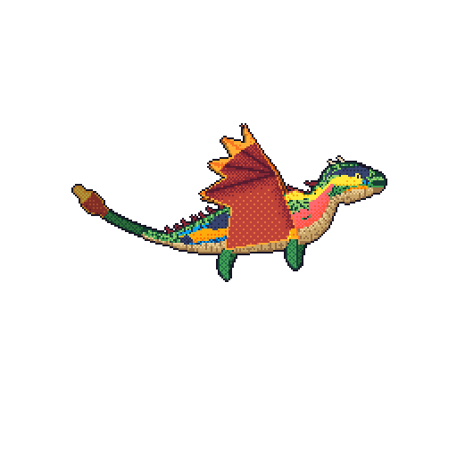
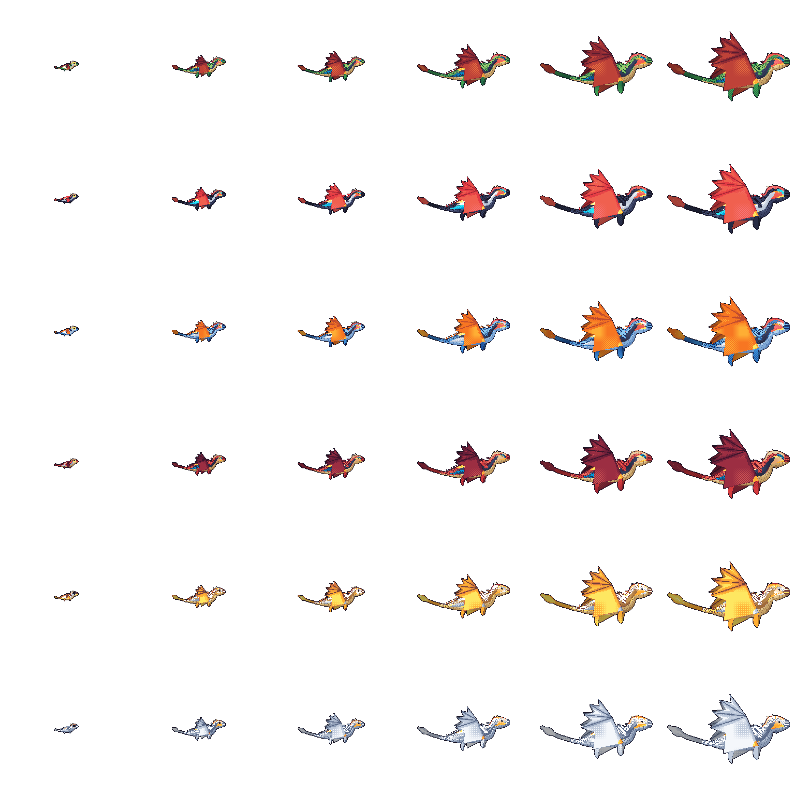

# Git dragon

Git dragon draws a pixel-art dragon from a GitHub account's public activity. Its
languages color it, its contributions grow it, its streaks mark it, and the day
that just ended decides how it flies. A hatchling grows bigger wings, horns, and a longer tail as contributions pile up, beats its wings harder on busy days, and breathes fire on the first active day of a week. A nightly workflow puts the dragon on a
profile README as a looping GIF, the same tool runs from the command line, and
the Rust library underneath is published on crates.io.

<p align="center">
  
</p>

<picture>
  <source media="(prefers-color-scheme: dark)" srcset="docs/bodies-dark.png" />
  
</picture>

## Repository Structure

```text
.
├── .github/      workflows, issue forms, and Dependabot
├── docs/         the getting-started guide and the render sheets
├── examples/     the profile workflow and the dragon library generator
├── src/          the library and the git-dragon command
├── tests/        the public-boundary tests and their fixtures
└── action.yml    the GitHub Action
```

## Usage

### Requirements

- For a dragon on your profile README: a GitHub account. The Action runs in your
  profile repository's workflow with its built-in token.
- For the command line: a binary from the
  [releases page](https://github.com/Saransh1220/git-dragon/releases), or Rust
  at or above the `rust-version` in [Cargo.toml](Cargo.toml), plus the
  [GitHub CLI](https://cli.github.com), authenticated.
- For the library: Rust at or above that same version.

[docs/getting-started.md](docs/getting-started.md) walks through all three: the
Action in a profile workflow, the command line, and the library. The API is
documented on [docs.rs](https://docs.rs/git-dragon).

## Credits

Git dragon is a fork of [git-koi](https://github.com/yalongwastaken/git-koi) by
**Anthony Yalong** ([@yalongwastaken](https://github.com/yalongwastaken)). The data
collection, growth, behavior, and rendering engine are his; this fork replaces the
koi with a pixel-art baby dragon that grows up.

Fork maintained by [@Saransh1220](https://github.com/Saransh1220).

## License

MIT. See [LICENSE](LICENSE).
